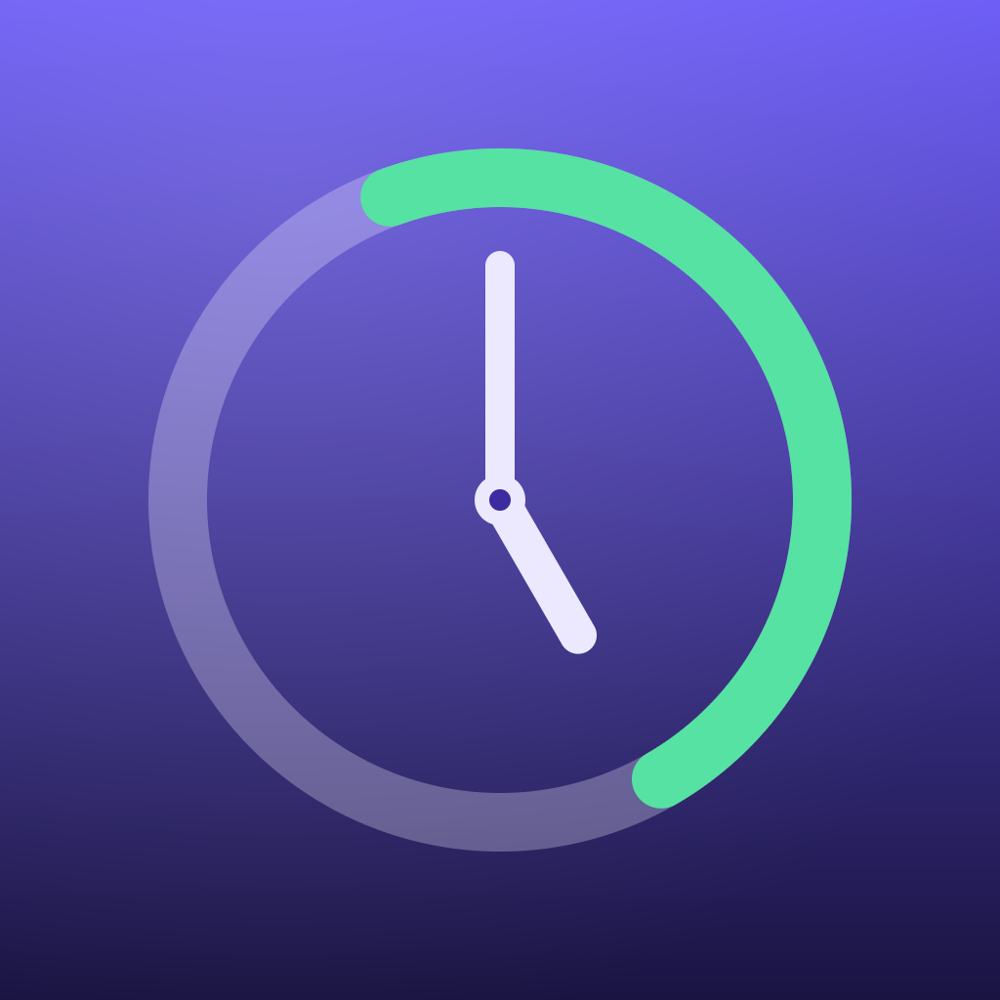

# Desbloqueos

App de iOS que te dice, cada vez que coges el iPhone, **cuánto tiempo aguantaste sin
desbloquearlo**. La idea no es contar pantalla, sino hacerte consciente de los ratos
que sí eres capaz de estar sin el teléfono.



## Qué hace

- **Pantalla principal**: la última pausa en grande ("2 horas y 14 minutos"), entre qué
  horas fue, y un contador en vivo desde el desbloqueo actual.
- **Objetivo de pausa**: un anillo que compara tu última pausa con el objetivo que te
  pongas (30 min, 1 h, 2 h o 4 h).
- **Tu día**: desbloqueos de hoy, pausa más larga del día (sin contar la noche), pausa
  media y a qué hora cogiste el teléfono por primera vez.
- **Gráficas**: desbloqueos por hora del día y por día de la semana.
- **Historial**: todos los desbloqueos agrupados por día, cada uno con la pausa previa.
- **Widget** de pantalla de inicio (pequeño y mediano) y de **pantalla de bloqueo**
  (circular, rectangular y en línea), con el contador corriendo en vivo.
- **Avisos opcionales**: "Llevas 2 horas sin desbloquear". Se programan al bloquear el
  teléfono y se cancelan al desbloquearlo, así que te los encuentras esperándote en la
  pantalla de bloqueo, justo cuando sirven de algo.

Todo se queda en el teléfono: no hay cuentas, ni servidores, ni analíticas.

## Cómo detecta los desbloqueos (y qué no puede hacer)

iOS **no ofrece ninguna API** que despierte a una app en cada desbloqueo. Cualquier app
que diga lo contrario está usando aproximaciones, y esta también. Estas son las señales
que sí existen y cómo se combinan:

| Señal | Cuándo llega | Uso |
|---|---|---|
| `protectedDataDidBecomeAvailable` | Al desbloquear el dispositivo, mientras la app siga en memoria | Es la detección buena: marca el instante exacto del desbloqueo aunque no abras la app |
| `protectedDataWillBecomeUnavailable` | Al bloquear el dispositivo | Programa los avisos y marca que hubo un bloqueo de verdad |
| Escena pasando a `.active` | Al abrir la app | Cubre el caso de que iOS haya descargado la app de memoria |

Dos detalles que evitan cifras infladas o duplicadas:

- El mismo desbloqueo puede avisarnos por dos vías a la vez, así que dos avisos separados
  por menos de 8 segundos cuentan como un solo evento.
- Volver de otra app **no** cuenta como desbloqueo si estuviste fuera poco tiempo y no
  vimos bloquearse el teléfono. El umbral es configurable en Ajustes (5 minutos por
  defecto), porque a partir de ahí el bloqueo automático de iOS ya ha entrado.

**Límite honesto**: si pasas días sin abrir la app ni mirar su widget, iOS puede haber
descargado el proceso de memoria y algún desbloqueo se perderá. Con el widget puesto en
la pantalla de bloqueo, la cuenta es fiable en el uso normal.

## Abrir el proyecto

Requisitos: **Xcode 16 o posterior** e **iOS 17 o posterior**.

```
open Desbloqueos.xcodeproj
```

Antes de ejecutarlo en tu iPhone hay que poner tus propios identificadores, porque los
del repositorio son los míos y no están firmados a tu nombre:

1. Selecciona el proyecto → target **Desbloqueos** → *Signing & Capabilities*:
   - Elige tu **Team**.
   - Cambia el **Bundle Identifier** a algo tuyo, por ejemplo `com.tunombre.desbloqueos`.
2. Haz lo mismo en el target **DesbloqueosWidgetExtension**, usando el mismo prefijo y
   acabando en `.widget` (por ejemplo `com.tunombre.desbloqueos.widget`).
3. En los dos targets, en *App Groups*, crea o elige un grupo tuyo, por ejemplo
   `group.com.tunombre.desbloqueos`.
4. Pon ese mismo grupo en `Packages/UnlockCore/Sources/UnlockCore/AppIdentifiers.swift`:

   ```swift
   public static let appGroup = "group.com.tunombre.desbloqueos"
   ```

   Los dos archivos `.entitlements` (`Desbloqueos/Desbloqueos.entitlements` y
   `DesbloqueosWidget/DesbloqueosWidget.entitlements`) también llevan el grupo escrito.

Si te saltas el paso del App Group, la app **sigue funcionando**: guarda los datos en su
propio contenedor y lo único que pasa es que el widget no ve el mismo historial. Ajustes
te avisa de ello con un indicador.

### Widget

Mantén pulsada la pantalla de bloqueo → *Personalizar* → añade el widget **Desbloqueos**.
En la pantalla de inicio, mantén pulsado un hueco → **+** → busca *Desbloqueos*.

## Estructura

```
Desbloqueos.xcodeproj
Desbloqueos/                    App (SwiftUI)
  DesbloqueosApp.swift
  Services/UnlockTracker.swift      Detección de desbloqueos y estado de la UI
  Services/MilestoneNotifier.swift  Avisos locales de pausas largas
  Views/                            Hoy, Historial, Ajustes y componentes
DesbloqueosWidget/              Extensión de widget (inicio y bloqueo)
Packages/UnlockCore/            Código compartido entre app y widget
  Sources/UnlockCore/
    UnlockEvent.swift               Modelo
    UnlockStore.swift               Persistencia en el App Group
    UnlockStats.swift               Estadísticas
    DurationText.swift              Duraciones en español
    Preferences.swift               Ajustes compartidos
  Tests/UnlockCoreTests/            Pruebas de la lógica
```

La lógica que importa (medir pausas, descartar duplicados, calcular estadísticas) vive en
el paquete `UnlockCore`, fuera de la interfaz, para poder probarla sin simulador.

## Pruebas

Las pruebas del paquete cubren el cálculo de pausas, el descarte de avisos duplicados, el
caso del reloj movido hacia atrás, las estadísticas del día y el formateo de duraciones.
Desde Xcode se ejecutan con ⌘U con el paquete seleccionado, o desde la terminal:

```
cd Packages/UnlockCore && swift test
```

## Estado

El proyecto se escribió en un contenedor Linux sin Xcode, así que **no se ha compilado
aquí**. La primera compilación en tu Mac es la que manda; si Xcode se queja de algo,
dímelo y lo arreglo.
